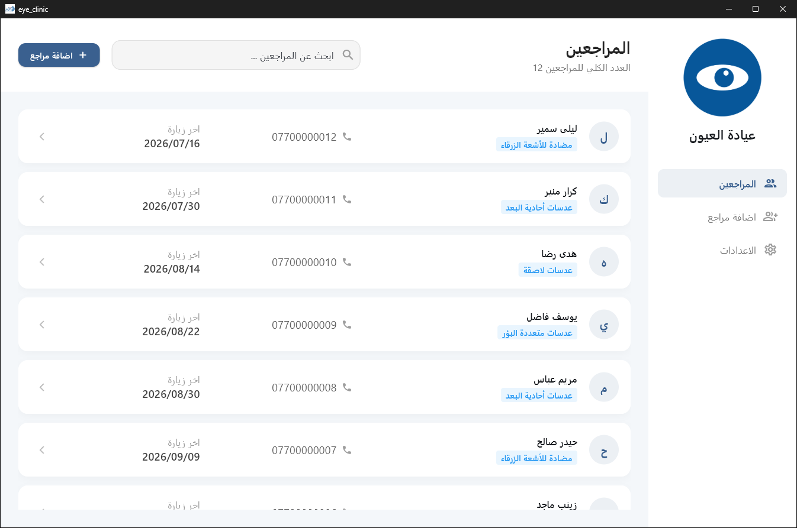
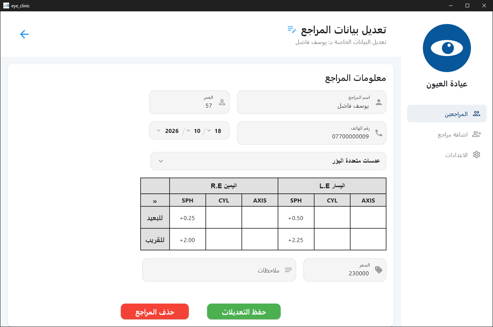
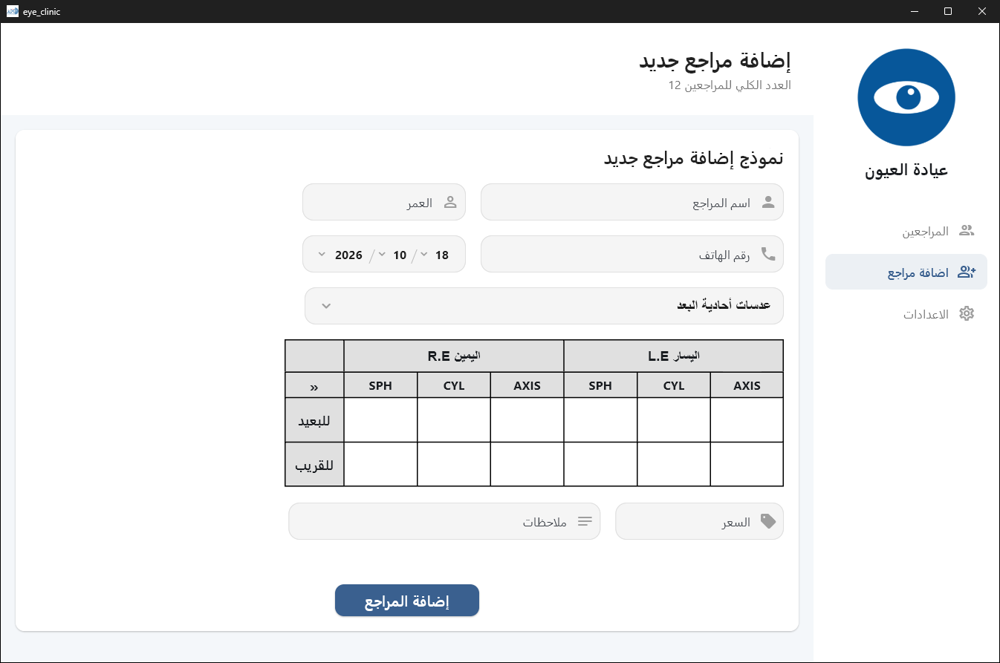
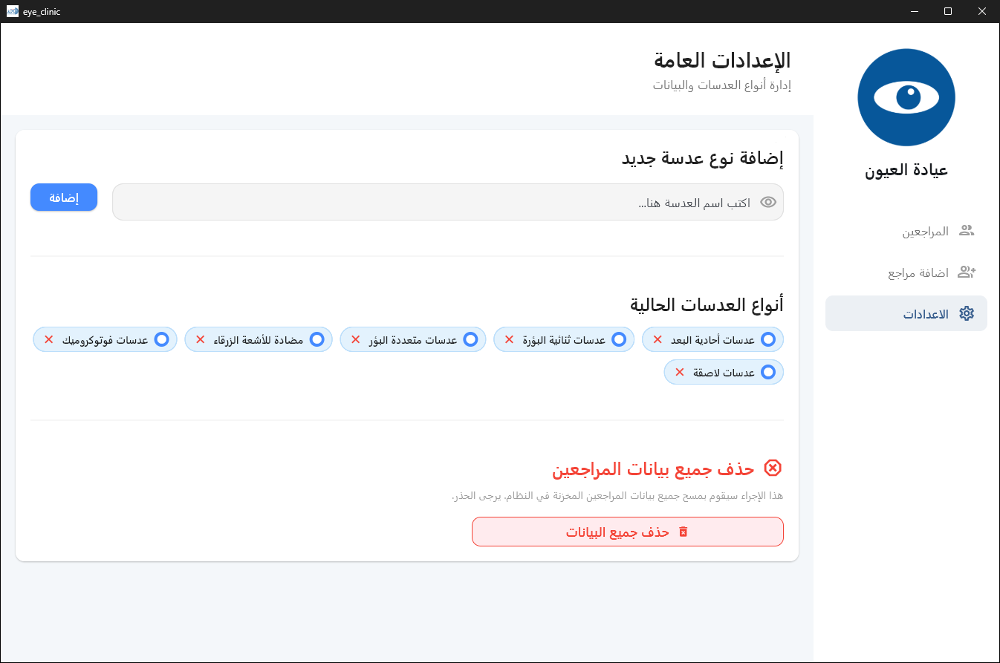

# Eye Clinic (عيادة / محل عيون)

**A simple Windows desktop app for an optical clinic or glasses shop**, built with Flutter.
Keep a record for every customer: contact details, the eye prescription (distance and near, right and left eye), the
lens type, the price and your notes, and find any record in a second.

The interface is **Arabic (right-to-left)**. Everything is stored **locally in a JSON file** next to the app: no
internet, no account, no database server.

> برنامج بسيط لإدارة المراجعين في عيادة أو محل نظارات: سجّل بيانات كل مراجع مع وصفة النظر (للبعيد والقريب، العين
> اليمنى واليسرى) ونوع العدسة والسعر، وابحث عنهم بسرعة. كل البيانات تُحفظ محلياً بجانب البرنامج.

---

## Screenshots

*All screenshots use made-up sample data and a placeholder logo.*

**Customer list** with search:



**Customer details**: edit the record and the eye prescription (distance and near, right and left eye):



**Add a customer**:



**Settings**: manage lens types or delete all data:



---

## Features

- **Customer list** with a live search box and a card for each customer (name, phone, last visit, lens type).
- **Add a customer**: name, age, phone, visit date, lens type, price and notes.
- **Eye prescription table** for each customer: **SPH / CYL / AXIS** for the **right eye (R.E)** and **left eye (L.E)**,
  for both **distance** and **near** vision.
- **Customer details page**: edit any field, save the changes, or delete the customer (with a confirmation).
- **Lens types** you define yourself: add or remove types in Settings and pick them when adding a customer.
- **Settings**: manage the lens types, or delete all customer data (with a warning).
- **Offline and portable**: data is saved to `app/db/data.json` beside the executable, so you can copy or back up the
  whole folder.

## Getting started

### Requirements

- Windows 10/11 (x64)
- [Flutter SDK](https://docs.flutter.dev/get-started/install/windows/desktop) 3.35+ (Dart `^3.9.2`) with Windows desktop support
  (Visual Studio with the "Desktop development with C++" workload)

### Run

```powershell
git clone https://github.com/Muntazer2030/eye_clinic_app.git
cd eye_clinic_app
flutter pub get
flutter run -d windows
```

### Build a release

```powershell
flutter build windows
```

The app is produced in `build\windows\x64\runner\Release\`. Copy that whole folder to the target PC and run
`eye_clinic.exe`.

## Where your data lives

The app keeps one JSON file at:

```
<folder of eye_clinic.exe>\app\db\data.json
```

It contains the `clients` list and the `lenses_types` list. The folder and file are created automatically on first
run. **Back up this file regularly**, and keep in mind it contains customers' personal information.

## Project structure

```
lib/
  main.dart                          app start and theme
  models/client.dart                 Client model (including the prescription)
  services/json_db_service.dart      small JSON file database
  ui/
    screens/home_screen/             main window and navigation
    screens/pages/                   customers list, add customer, customer details, settings
    widgets/                         customer card, prescription table, lens type picker, date picker
```

## Built with

[Flutter](https://flutter.dev) · [auto_size_text](https://pub.dev/packages/auto_size_text) ·
[path](https://pub.dev/packages/path)

## License

No license has been chosen yet. All rights reserved by the author until one is added.
